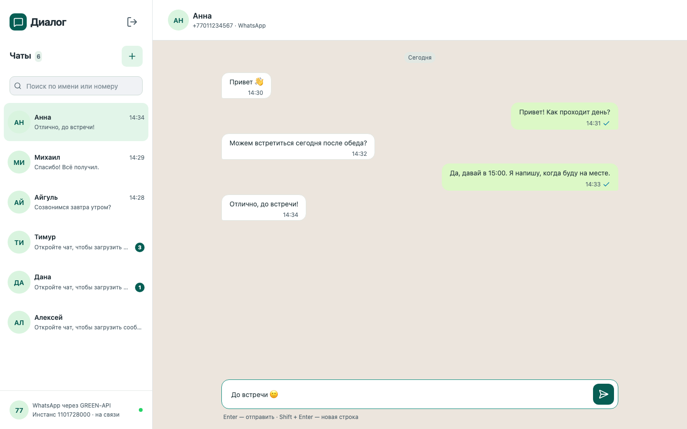
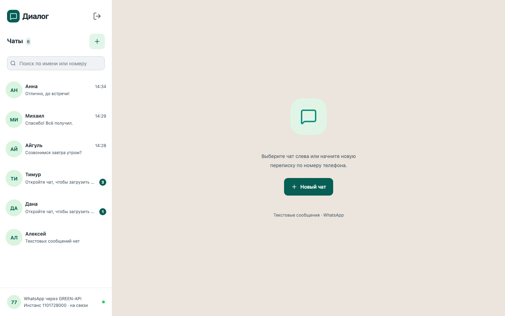
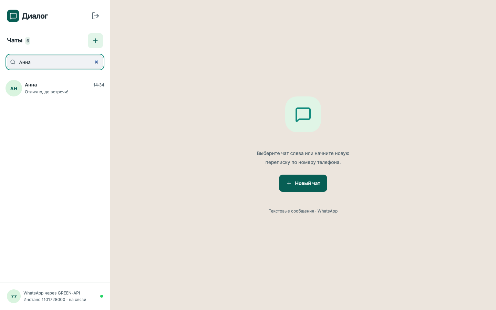
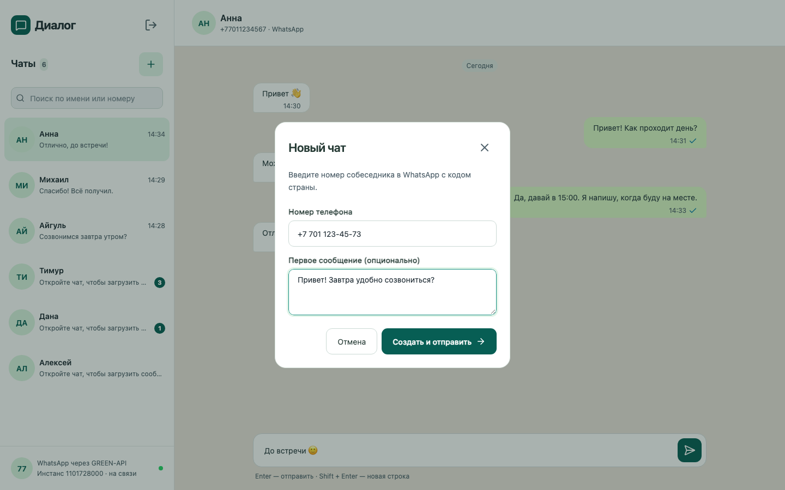
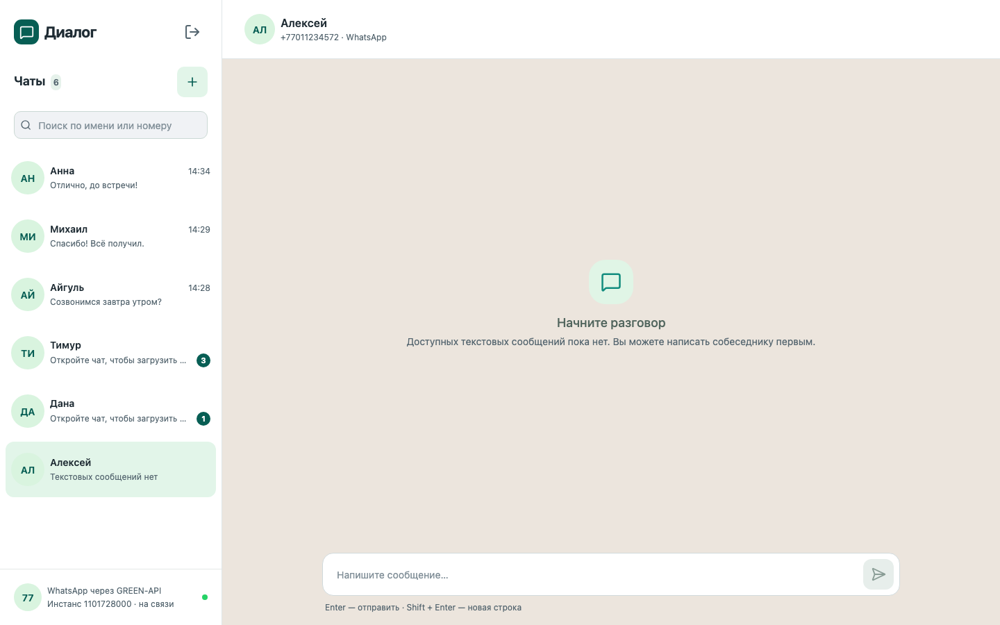
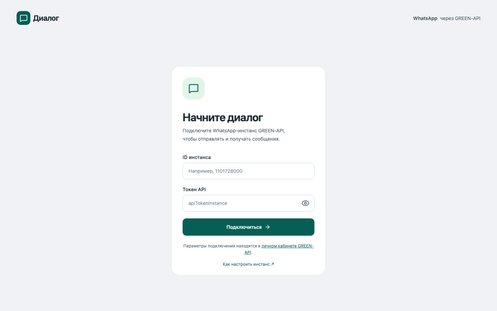
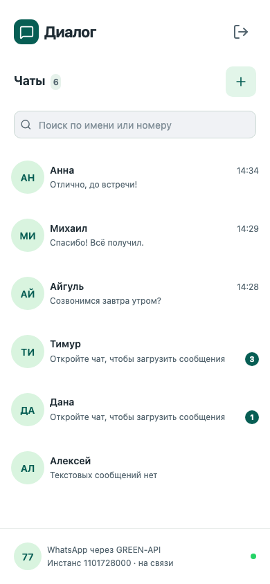
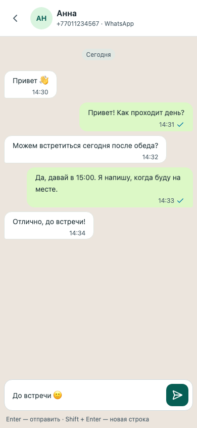

# Диалог

[Открыть приложение](https://mywebstack.github.io/green-api-whatsapp-chat/)

Веб-клиент для личной переписки в WhatsApp через [GREEN-API](https://green-api.com/). Поиск по чатам, история сообщений, фотографии собеседников, непрочитанные, отправка и удаление своих сообщений. Переписка и черновики хранятся в памяти до обновления страницы.



<details>
<summary>Другие экраны</summary>







 

Скриншоты с демонстрационными данными.

</details>

## Запуск

Нужны Node.js 24 и авторизованный WhatsApp-инстанс GREEN-API.

```bash
npm ci
npm run dev
```

Откройте адрес из вывода Vite и введите `idInstance` и `apiTokenInstance` из [личного кабинета](https://console.green-api.com/).

В настройках инстанса включите входящие уведомления и очистите `Webhook URL`. Для сообщений, отправленных с телефона, включите исходящие уведомления.

После входа появится список чатов. Новый разговор можно начать по номеру, например `+7 701 123-45-67`, сразу указав первое сообщение.

## Архитектура

React отвечает за интерфейс, `ChatRuntime` — за подключение и сообщения. Запросы к GREEN-API выполняются из браузера.

- `chat/domain` — модели и функции изменения данных.
- `chat/application` — сценарии и контракты зависимостей.
- `chat/infrastructure` — API и валидация через Zod.
- `chat/ui` — компоненты и SCSS-модули.
- `session` — подключение и координация вкладок.
- `app` — контекст и общие стили.

Подключение хранится в `sessionStorage`, последний открытый чат — в `localStorage`, переписка — только в памяти. Очередь читает одна вкладка, изменения передаются остальным через BroadcastChannel. После закрытия читателя другая вкладка подхватывает очередь.

Уведомления подтверждаются после обработки; повторные события не создают дубли. При таймауте получения проверяется состояние инстанса. Исходящие сообщения автоматически не повторяются, чтобы избежать двойной отправки. История и фото загружаются при открытии чата, прочтение учитывается сразу в открытом видимом чате и синхронизируется через `ReadChat`.

## Ограничения

- Только личные текстовые чаты; при открытии загружается до 100 последних сообщений из журнала GREEN-API.
- «Принято API» не означает доставку. Удаление у всех доступно для своих сообщений в пределах 60 часов.
- После обновления страницы чаты и история загружаются заново; черновики сбрасываются.
- Токен доступен JavaScript: используйте доверенный HTTPS-хост и не добавляйте учётные данные в репозиторий.

## Проверки и сборка

```bash
npm run check
npx playwright install chromium firefox webkit
npm run test:e2e
```

`check` запускает TypeScript, ESLint, модульные тесты и сборку. E2E-тесты работают с подменённым API.

[CI](./.github/workflows/ci.yml) проверяет pull request и публикует приложение в GitHub Pages после push в `main`. Для другого хоста разместите `dist` после `npm run build`; базовый путь задаётся через `BASE_PATH`.
